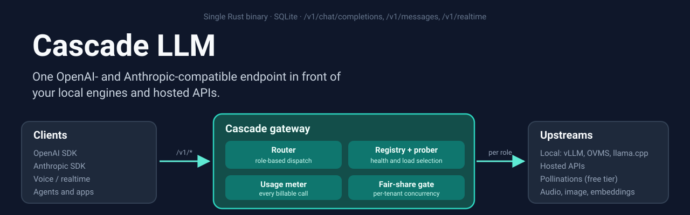
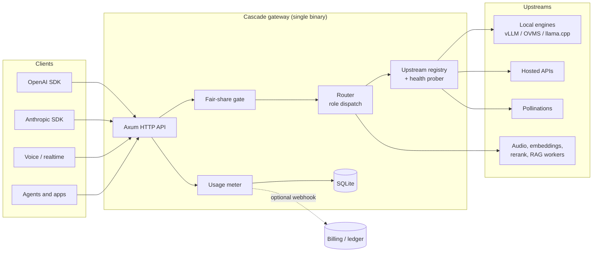

# Cascade LLM

<p align="center">
  
</p>

**Cascade** is a self-hosted, OpenAI-compatible (and Anthropic-compatible) LLM gateway written in Rust.
Point your existing SDKs at one endpoint, and Cascade routes each call to the right backend: a
local vLLM, OpenVINO or llama.cpp server, a hosted API, or a free hosted tier. It ships as a single
binary with a built-in SQLite store and a web console, and it meters every billable call.

## Who is this for

- **Any developer building an AI stack** who runs models locally and wants one stable URL for
  chat, embeddings, audio, images and realtime voice, whatever engine serves them underneath.
- **Teams mixing local and external providers** who want one place to register, weight, health-check,
  enable and disable backends, and to see which node served which request.
- **Platform and SaaS builders** who need per-tenant usage metering and a fair-share concurrency
  limit so one noisy client cannot starve the others.
- **Anyone who wants the gateway to stay on-premise.** Cascade has no required cloud dependency:
  the only outbound calls are to the upstreams you configure.

Cascade is a general-purpose gateway. It is also the central LLM entry point of the NetAI Stack SE
self-hosted platform, but it runs standalone and has no NetAI-specific requirements.

## Features

### API compatibility
- `POST /v1/chat/completions` (OpenAI Chat Completions, streaming via SSE)
- `POST /v1/messages` and `POST /v1/messages/count_tokens` (Anthropic Messages API, including the SSE event protocol)
- `GET /v1/models` (the models the gateway currently serves)
- `POST /v1/embeddings`, `POST /v1/rerank` (pass-through to the embeddings service)
- `POST /v1/audio/speech` (TTS), `POST /v1/audio/transcriptions` (STT), `POST /v1/audio/diarize`
- `POST /v1/images/generations`, `POST /v1/video/generations`
- `GET /v1/realtime` (OpenAI-Realtime-compatible WebSocket proxy to the STT realtime upstream)

### Routing and upstreams
- **Role-based dispatch**: `main`, `auxiliary`, `ocr`, `image` and `rag_worker` pools, each with its own
  nodes and static fallback URLs from the environment.
- **Dynamic upstream registry**: register, update, toggle and remove nodes at runtime through the admin
  API, with no gateway restart. Re-registering the same URL or `id` updates the node in place.
- **Selection strategies**: weighted round-robin (default) or least-latency, over active and healthy nodes.
- **Health prober**: periodic health sweeps with configurable interval, timeout and failure threshold;
  an immediate sweep can be triggered from the API.
- **Circuit breaker** settings (`CIRCUIT_BREAKER_THRESHOLD`, `CIRCUIT_BREAKER_RESET_SECS`).
- **Hosted adapters**: Pollinations nodes for image generation and text models; a free image fallback
  selected by `CASCADE_IMAGE_MODE`.
- **Routing transparency**: responses carry `x-cascade-route` (backend class) and `x-cascade-node`
  (registry node id) headers.
- **Per-request route decision** (`src/state.rs`, `inspect_route`), checked in this order:
  1. Settings pin: `CASCADE_DEFAULT_ROUTE=inference|auxiliary` overrides the payload.
  2. Explicit hint: header `x-cascade-route` (also `x-cascade-mode`, `x-router-mode`, `x-route-mode`,
     `x-router`) or body key `route`/`mode`/`target`/`routing`. Accepted values include `inference`,
     `inference-server`, `main`, `large`; `auxiliary`, `auxiliary-server`, `aux`, `small`, `compression`,
     `summary`, `subagent`; `ocr`, `document`, `vision`; and `auto`, `auto-small`, `auto-large`,
     `complexity`, `session-affinity`. Unknown values fall back to main.
  3. **Condition B, agent compression**: system-message markers from agent compression hooks send the
     request to the auxiliary model. `MARKER_MODE` selects `substring` (default) or `prefix` matching.
  4. **Condition A, document/OCR**: uploaded documents, image attachments and explicit `document`/`ocr`
     flags go to the `ocr` pool, but only while an active `ocr` node is registered. Otherwise the
     multimodal main or auxiliary backend parses them.
  5. **Condition C, hybrid**: with `CASCADE_HYBRID_AUTO=true` and no pinned default route, a short, plain,
     single-turn, text-only, tool-less prompt goes to the auxiliary model (see the X-Tier section and
     configuration reference for thresholds).
  6. Default: main inference.
- **Complexity routing on the `auto` path**: a keyword and length score is compared with
  `ROUTER_THRESHOLD` (default `0.5`). Scores at or below it go to the small (auxiliary) model; higher
  scores go to the large (main) model. Keywords are matched per language (en, de, fr, es, it, pl, hu).
- **Tool-aware routing**: a request that declares `tools` or `functions` goes to the main model when
  `ROUTE_TOOLS_TO_LARGE=true` (default). Session affinity keeps a conversation that already used tools on
  the main model.
- **Vision fallback**: when the main model is text-only (`LARGE_MODEL_MULTIMODAL=false`), image requests
  go to the auxiliary multimodal model. If the variable is unset, the gateway probes
  `MULTIMODAL_CAPABILITY_URL` at startup.
- **Confidence rerouting**: when the small model answers, its token logprobs are checked against
  `CONFIDENCE_THRESHOLD` (default `0.7`). A low score, or a fallback tag in the small model's output,
  reroutes the original request to the large model.
- **Intent bypass**: planning, design, security and meta requests go directly to the large model.
- **X-Tier header**: `x-tier: premium` sends the request to the large model, bypassing complexity
  scoring. Any other value, including the default `standard`, uses normal complexity routing. See
  [X-Tier](#x-tier-header) below.

### Metering and billing hooks
- **One usage event per billable call**: chat, completions, embeddings, audio, images, video and realtime
  voice sessions are recorded in the local SQLite ledger.
- Attribution from request headers: `X-Billing-Tenant`, `X-Billing-User-Id`, `X-Billing-Source`,
  `X-Billing-Metered`.
- Events can be shipped to a webhook (`CASCADE_USAGE_WEBHOOK_URL`, optional `CASCADE_USAGE_WEBHOOK_KEY`);
  metering can be turned off with `CASCADE_USAGE_ENABLED=false`, and retention is set with
  `CASCADE_USAGE_RETENTION_DAYS`.
- Admin usage report at `/api/v1/admin/usage`.

### Multi-tenant fairness
- **Per-tenant fair-share concurrency gate** on `/v1/chat/completions` and `/v1/messages`.
  Off by default. Set `CASCADE_TENANT_MAX_CONCURRENCY`, optionally per plan with
  `CASCADE_TENANT_CONCURRENCY_BY_PLAN`. Requests over the limit wait up to
  `CASCADE_TENANT_QUEUE_WAIT_SECS`, then receive HTTP 429 with `Retry-After`.
- Requests without a tenant header are not limited.

### Media, audio and realtime
- TTS, STT (with diarization), image and video generation, and embeddings/rerank proxies.
- Realtime voice WebSocket proxy at `/v1/realtime`, so a voice client can switch between the STT service
  and Cascade by changing only the URL.
- Document extraction for RAG workers at `/v1/rag/extract`, routed to the `rag_worker` pool.

### Admin console and admin API
- Web console at `/web/`: **Overview**, **Backends** (pool and health prober), **GPU fleet**,
  **Providers** (with **Register an API**), **Models**, **Routing**, **Diagnostics**, and a settings page
  with the reference docs at `/web/settings`.
- Admin API for upstreams, nodes, providers, routing strategy and settings, guarded by the
  `x-cascade-admin-key` header (`CASCADE_ADMIN_KEY`). When the key is unset, the admin routes are disabled.
- Endpoint and API documentation: [`docs/dynamic-upstreams.md`](docs/dynamic-upstreams.md),
  [`docs/anthropic-api.md`](docs/anthropic-api.md), [`docs/routing-settings.md`](docs/routing-settings.md).

### Observability and health
- `GET /health` (also `/web/api/health`) for liveness and upstream state.
- Prometheus metrics at `/web/metrics`.
- Dashboard and overview snapshots at `/web/api/dashboard` and `/web/api/overview`.
- Structured logs through `tracing`.

## Architecture



## Quick start

### Build and run from source

Requires a recent stable Rust toolchain.

```bash
cargo build --release
./target/release/cascade-llm
```

The gateway listens on `0.0.0.0:3000`. The console is at `http://localhost:3000/web/`.

### Docker

The repository's `Dockerfile` builds a release binary and runs it on a distroless base:

```bash
docker build -t cascade-llm .
docker run -p 3000:3000 \
  -e LARGE_TEXT_URL=http://host.docker.internal:8080/v1/chat/completions \
  -e SMALL_MLLM_URL=http://host.docker.internal:8082/v1/chat/completions \
  -v cascade-data:/data \
  cascade-llm
```

The state database defaults to `/data/cascade.db` (`CASCADE_DB`), so mount a volume there to keep usage
and registry data across restarts. The CI workflow in `.github/workflows/` publishes the image on pushes
to `main` and on `v*` tags.

### Minimal configuration

Every upstream has a default, and the defaults are Docker service names (for example
`http://inference-server:8080/v1/chat/completions`). Set the ones that match your engines:

```bash
export LARGE_TEXT_URL=http://localhost:8080/v1/chat/completions   # main chat backend
export SMALL_MLLM_URL=http://localhost:8082/v1/chat/completions   # auxiliary backend
export CASCADE_ADMIN_KEY=change-me                                # enables the admin API
./target/release/cascade-llm
```

For a larger setup, put upstream pools in a YAML file and point `CASCADE_CONFIG_FILE` at it. The file
seeds the registry and settings at boot, and environment variables take precedence over file values.
Nodes can also be added at runtime through the console or the admin API.

### First request

```bash
# OpenAI-compatible
curl http://localhost:3000/v1/chat/completions \
  -H "Content-Type: application/json" \
  -d '{"model":"cascade-hybrid-v1","messages":[{"role":"user","content":"Hello"}]}'

# Anthropic-compatible
curl http://localhost:3000/v1/messages \
  -H "Content-Type: application/json" \
  -H "anthropic-version: 2023-06-01" \
  -d '{"model":"cascade-hybrid-v1","max_tokens":256,"messages":[{"role":"user","content":"Hello"}]}'
```

The model name `cascade-hybrid-v1` is the default value of `CASCADE_MODEL_NAME`. Set it to any name you like.

## API overview

| Method | Path | Purpose |
|---|---|---|
| POST | `/v1/chat/completions` | OpenAI Chat Completions (streaming supported) |
| POST | `/v1/messages` | Anthropic Messages API |
| POST | `/v1/messages/count_tokens` | Anthropic token counting |
| GET | `/v1/models` | Models served by the gateway |
| POST | `/v1/embeddings` | Embeddings pass-through |
| POST | `/v1/rerank` | Reranking pass-through |
| POST | `/v1/audio/speech` | Text-to-speech |
| POST | `/v1/audio/transcriptions` | Speech-to-text |
| POST | `/v1/audio/diarize` | Speaker diarization |
| GET | `/v1/realtime` | Realtime voice WebSocket |
| POST | `/v1/images/generations` | Image generation |
| POST | `/v1/video/generations` | Video generation |
| POST | `/v1/rag/extract` | Document extraction (`rag_worker` pool) |
| GET | `/health` | Health check |
| GET | `/web/` | Admin console |
| PUT / DELETE | `/web/api/upstreams/{role}` | Register or remove upstream nodes (admin) |
| GET | `/api/v1/admin/upstreams` | Pool status and telemetry |
| POST | `/api/v1/admin/upstreams/probe` | Trigger an immediate health sweep |
| POST | `/api/v1/inference-nodes/{id}/activate` · `/deactivate` | Toggle a node |
| GET | `/api/v1/admin/usage` | Usage report (admin) |
| GET / PUT | `/web/api/providers`, `/web/api/settings`, `/web/api/routing-strategy` | Providers, settings, routing strategy (admin for writes) |
| GET | `/web/metrics` | Prometheus metrics |

Each route is also served under `/api/...` and `/web/api/...` for backward compatibility. Admin
routes take the `x-cascade-admin-key` header. Extraction, GPU provisioner and dashboard routes are
listed in `src/router.rs`.

## X-Tier header

`x-tier` is read on `/v1/chat/completions` and `/v1/messages` (`src/handlers.rs`, `src/anthropic.rs`).

| Value | Effect |
|---|---|
| `premium` | Complexity scoring is skipped and the request goes to the large (main) model. |
| `standard` (default) | Normal complexity routing. |
| any other value | Treated the same as `standard`. |

The tier is applied only on the auto path, that is, when the route decision is `auto` (for example
through an `auto`, `auto-small`, `auto-large`, `complexity` or `session-affinity` hint). Tool-carrying
requests, intent bypass and an existing session-affinity route are resolved first and keep their target
even when the tier is `premium`.

```bash
curl http://localhost:3000/v1/chat/completions \
  -H "Content-Type: application/json" \
  -H "x-cascade-route: auto" \
  -H "x-tier: premium" \
  -d '{"model":"cascade-hybrid-v1","messages":[{"role":"user","content":"Hello"}]}'
```

## Configuration reference

The most relevant variables. Full defaults are in `src/config.rs`.

### Upstreams

| Variable | Default | Purpose |
|---|---|---|
| `LARGE_TEXT_URL` | `http://inference-server:8080/v1/chat/completions` | Main text backend |
| `LARGE_MLLM_URL` | `http://inference-server:8080/v1/chat/completions` | Main multimodal backend |
| `SMALL_MLLM_URL` | `http://auxiliary-server:8080/v1/chat/completions` | Auxiliary backend |
| `OCR_URL` | `http://ocr-server:8082/v1/chat/completions` | OCR backend |
| `INFERENCE_URL` | `http://netai-inference:8080` | Inference base URL |
| `IMAGE_GENERATION_URL` | `http://localhost:8080/v1/images/generations` | Image fallback |
| `VIDEO_GENERATION_URL` | `http://localhost:8080/v1/video/generations` | Video backend |
| `TTS_URL` | `http://speech-tts:8800/v1/audio` | Text-to-speech |
| `STT_URL` | `http://speech-stt:5092/v1/audio` | Speech-to-text |
| `STT_REALTIME_URL` | `ws://speech-stt:5093/v1/realtime` | Realtime STT (WebSocket) |
| `EMBEDDINGS_URL` / `RERANK_URL` | `http://embeddings:8801` | Embeddings and rerank |
| `LLAMA_API_KEY` | none | Bearer token for static local upstreams |
| `MODEL_NAME` labels | see `src/config.rs` | `MAIN_MODEL_NAME`, `SMALL_MODEL_NAME`, `OCR_MODEL_NAME` |
| `CASCADE_MODEL_NAME` | `cascade-hybrid-v1` | Model name the gateway advertises |

### Routing

| Variable | Default | Purpose |
|---|---|---|
| `CASCADE_ROUTING_STRATEGY` | `round_robin` | `round_robin` (weighted) or `least_latency` |
| `CASCADE_DEFAULT_ROUTE` | none | Pin every request to `inference` or `auxiliary`. `ocr` is retired and ignored. |
| `ROUTER_THRESHOLD` | `0.5` | Complexity score above which the `auto` path uses the large model |
| `CONFIDENCE_THRESHOLD` | `0.7` | Minimum small-model token confidence before its answer is kept |
| `ROUTE_TOOLS_TO_LARGE` | `true` | Send requests that declare tools to the main model |
| `LARGE_MODEL_MULTIMODAL` | unset (auto-detect) | Whether the main model accepts images. If unset, probed via `MULTIMODAL_CAPABILITY_URL` (default `http://inference-server:18081/multimodal-capability`) |
| `MARKER_MODE` | `substring` | Compression and document marker matching: `substring` or `prefix` |
| `CASCADE_MODEL_NAME` | `cascade-hybrid-v1` | Unified model id the gateway advertises and accepts |
| `CASCADE_HYBRID_AUTO` | `false` | Enable hybrid Condition C (short plain prompts to the auxiliary model) |
| `CASCADE_HYBRID_AUX_MAX_CHARS` | `600` | Length budget for a prompt to count as simple (`0` disables the gate) |
| `CASCADE_IMAGE_MODE` | `local_free` | `local`, `local_free` or `free` |
| `CASCADE_EXTRACTION_STRATEGY` | see `src/config.rs` | Extraction backends: `priority` or `round_robin` |
| `CIRCUIT_BREAKER_THRESHOLD` / `CIRCUIT_BREAKER_RESET_SECS` | `5` / `60` | Static-upstream circuit breaker |
| `HEALTH_CHECK_INTERVAL_SECS` / `_TIMEOUT_SECS` / `_FAILURE_THRESHOLD` | `30` / `5` / `2` | Health prober (interval min 5 s) |

### Metering and fairness

| Variable | Default | Purpose |
|---|---|---|
| `CASCADE_DB` | `/data/cascade.db` | SQLite state file |
| `CASCADE_USAGE_ENABLED` | `true` | Record usage events |
| `CASCADE_USAGE_WEBHOOK_URL` / `CASCADE_USAGE_WEBHOOK_KEY` | none | Ship usage events to a billing service |
| `CASCADE_USAGE_FLUSH_SECS` | `5` | Webhook flush interval |
| `CASCADE_USAGE_RETENTION_DAYS` | `30` | Local ledger retention |
| `CASCADE_TENANT_MAX_CONCURRENCY` | `0` (off) | Per-tenant concurrency limit |
| `CASCADE_TENANT_CONCURRENCY_BY_PLAN` | none | Per-plan limits |
| `CASCADE_TENANT_QUEUE_WAIT_SECS` | `30` | Queue wait before HTTP 429 |

### Admin and configuration file

| Variable | Default | Purpose |
|---|---|---|
| `CASCADE_ADMIN_KEY` | unset (admin API disabled) | Key for `x-cascade-admin-key` |
| `CASCADE_CONFIG_FILE` | none | Optional YAML file seeding upstreams and settings |
| `CASCADE_HOST_GATEWAY` | `false` | Opt-in host-gateway handling for node URLs (see `src/registry.rs`) |
| `GPU_PROVISIONER_URL` / `GPU_PROVISIONER_API_KEY` | see `src/config.rs` | GPU provisioner passthrough (`/web/api/provisioner/*`) |
| `EXTRACT_CLOUD_URL` / `EXTRACT_CLOUD_API_KEY` / `EXTRACT_CLOUD_MODEL` | none | Cloud extraction backend |

The listening port is fixed at 3000 in `src/main.rs`.

## Integration with NetAI Stack SE

In the NetAI Stack SE deployment, Cascade is the single LLM entry point: LibreChat, the agent, voice
chat, dictation and LightRAG all send their model calls through it, and it meters them for the billing
service. Nothing in Cascade depends on NetAI, so the same binary works as a standalone gateway in any
other stack.

## Development and testing

```bash
cargo build                 # debug build
cargo test                  # unit tests and integration tests in tests/
cargo clippy --all-targets  # lints
cargo fmt --check           # formatting
```

Integration tests in `tests/` exercise the router, the upstream registry, the Anthropic layer, the
console API, audio URL handling and fallback behaviour without a live model backend.

## License

Cascade LLM is released under the MIT License. See [`LICENSE`](LICENSE).
